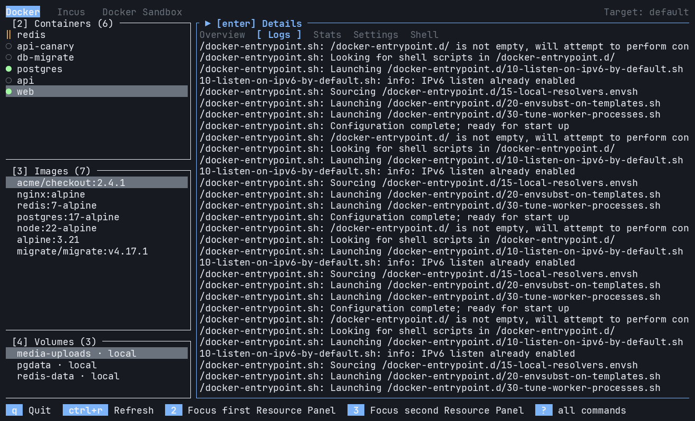

# Tuivir



A terminal UI for managing VMs, containers, and microVMs.

Works with Docker, Incus, Docker Sandbox, and Tart. Apple Container support is
experimental.

## Install

**Homebrew (macOS or Linux x86-64)**

```sh
brew install saif97/tap/tuivir
```

The tap supports macOS Apple Silicon and Intel, and Linux x86-64. Linux ARM64
and other architectures are not supported by the tap.

**Linux binary (x86-64)**

```sh
curl -fL https://github.com/saif97/Tuivir/releases/download/v0.3.0/tuivir-v0.3.0-x86_64-unknown-linux-musl.tar.gz | tar -xz
mkdir -p ~/.local/bin
install -m 755 tuivir-v0.3.0-x86_64-unknown-linux-musl/tuivir ~/.local/bin/tuivir
export PATH="$PATH:$HOME/.local/bin"
tuivir --version
```

The `export` line adds `~/.local/bin` to the end of your existing `PATH` for
this terminal, preserving existing entries and their priority. Skip it if that
directory is already on your `PATH`. To keep it in new terminals, add the line
once to `~/.bashrc` (Bash) or `~/.zshrc` (Zsh).

Find newer versions and checksums on the
[releases page](https://github.com/saif97/Tuivir/releases). To upgrade, repeat
these steps with the newer version. To uninstall, run `rm ~/.local/bin/tuivir`.

**From source (Linux or macOS)** — requires [Rust](https://rustup.rs/).

```sh
git clone https://github.com/saif97/Tuivir.git
cd Tuivir
cargo install --locked --path .
```

Ensure `~/.cargo/bin` is on your `PATH`.

## Usage

Install your provider's CLI and start its service, then run:

```sh
tuivir
```

Tuivir discovers installed providers automatically. Browse resources, inspect
logs and stats, open shells, and manage resource lifecycles. Supported resources
also offer CPU and memory editing in **Settings**.

Press `?` for help or `q` to quit. The footer shows available commands.

## Configuration

Create `~/.config/tuivir/config.toml` to customize keybindings:

```toml
[keybindings]
app_quit = ["q"]
app_refresh = ["ctrl+r"]
```

Only include commands you want to change. Each list replaces the defaults;
`[]` disables a command. Keys are case-sensitive.

Tuivir also respects `$XDG_CONFIG_HOME/tuivir/config.toml`. Set
`TUIVIR_CONFIG_FILE` to an absolute path to use another file.

## Development

Run tests with `cargo test --locked`. See [Releasing](docs/releasing.md) for the
release process.

## License

[MIT](LICENSE-MIT) or [Apache 2.0](LICENSE-APACHE).
